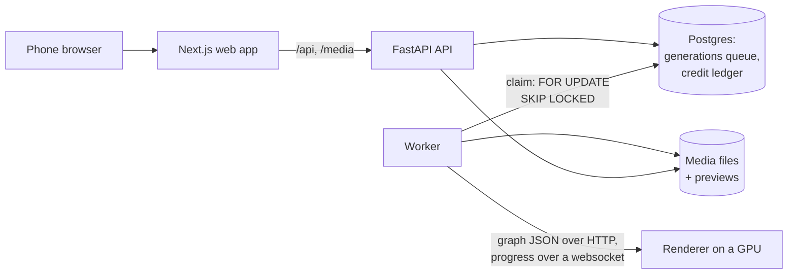

# unnoodle

Pictures and videos from one prompt, built for phones. Describe what you want, attach a photo or a clip if you have one,
and press Generate. No nodes to wire and no settings to learn.


Open image and video models are good now, but running them usually means a canvas of nodes, model files and settings
with names like CFG and denoise. unnoodle does that part on the server: it picks the model from what you ask for and
what you attach, builds the steps for that one request, and runs them on a GPU.

## What it does

| Ask for                                                                                                        | Model        | Out of the app                                                                                                              |
| -------------------------------------------------------------------------------------------------------------- | ------------ | --------------------------------------------------------------------------------------------------------------------------- |
| A picture: _a white ceramic teapot painted with a blue fish, product photo on a white table_                   | Krea 2 Turbo |                                                                 |
| An edit of one photo: _@photo1 wears a black leather jacket instead of the raincoat, same pose and background_ | FLUX.2 Klein |  →  |
| A mix of photos: _@photo1 holds the teapot from @photo2 in both hands, in a sunny kitchen_                     | FLUX.2 Klein |                                                                |
| A video with sound, from text, photos or clips: _@photo1 pours tea from the teapot in @photo2 into a cup…_     | MiniMax H3   | the middle video above                                                                                                      |

- **Settings in words:** low, medium or high quality; a shape like portrait or wide, or "same as" an attachment; 5, 10
  or 15 seconds for a video.
- **@mentions:** each attachment gets a handle (`@photo1`, `@clip1`) so the prompt can say which is which.
- **Up to four at once:** one tap queues several takes of a prompt, each with the next seed.
- **Projects:** generations go in folders, and anything you made can go back in as an input.
- **Credits:** the price is on the Generate button before you press it. For now credits come from invite codes and
  admins; there is no payment.

## How it works



- **One address for the phone.** The browser only talks to the Next.js app, which passes `/api/*` and `/media/*` to the
  API, so there's no cross-origin setup. While anything is queued or running, the app re-reads the generations every
  second; otherwise only when the tab regains focus.
- **The queue is a table.** `POST /generations` checks the request, charges for it and inserts rows; a Postgres
  `NOTIFY` wakes an idle worker. A worker claims the oldest queued row with `SELECT … FOR UPDATE SKIP LOCKED`, so
  several workers never take the same job, and then holds it as a lease: it refreshes a heartbeat while it runs, and a
  job whose heartbeat goes stale for 60 s is claimed again, up to 3 attempts. A run that takes more than 3× its
  estimate (never less than 2 minutes) is stopped on the renderer and failed with a plain message.
- **Pipelines are code.** Each model is a pipeline: what it accepts (photos and clips per role), what it offers
  (qualities, shapes, lengths), and a function that builds the node graph for one request, with one image chain per
  attached photo. Routing picks the pipeline from the mode and the attachments, and the worker sends the built graph to
  the renderer, a node-graph inference server. `app/pipelines.py` describes the contract; `app/catalogues/real.py` holds
  the three models and `app/catalogues/dev.py` stand-ins that need no GPU.
- **Everything is scoped to its owner.** Every query filters by the signed-in account; someone else's generation,
  upload or project answers 404, and `/media` files are served only to their owner (plus a shared Demo project that
  every account can read). Sessions are random tokens in an httpOnly cookie; the database keeps only their SHA-256.
- **Credits are a ledger.** Every grant, charge and refund is a row in an append-only `credit_entries` table, so a
  balance is a sum and every change can be traced. Queuing charges under a row lock on the account, so two requests
  can't spend the same credits, and a failed generation is refunded in the same transaction that marks it failed.
- **Media.** Uploaded clips are cut with ffmpeg to what the video model uses. Every video gets a poster frame and every
  picture a WebP preview of at most 960 px, so grids never load the full file. Private media skips Next's image
  optimizer, which fetches without the visitor's cookie and caches for everyone.

## Decisions, with the numbers behind them

The real models were run end to end once, on one rented RTX 5090 (32 GB, $1.19 an hour, about 45 minutes, so about $1
in all), driven through the API. Everything measured is in [`dev/metrics/runpod-5090-2026-10-16`](dev/metrics/runpod-5090-2026-10-16).

| Generation                              | Time on the GPU | GPU cost at $1.19/h |
| --------------------------------------- | --------------- | ------------------- |
| Picture (Krea 2, low to high)           | 3–11 s          | under $0.01         |
| Photo edit (Klein, 1–3 photos)          | 7–27 s          | under $0.01         |
| Video, low, 5 s, from 2 photos          | 86 s            | $0.03               |
| Video, medium, 10 s, text only          | 253 s           | $0.08               |
| Video, medium, 10 s, with 2 video clips | 851 s           | $0.28               |

- **Reference clips are cut to 0.4 megapixels.** The video model works through every frame of a reference clip as well
  as the frames it makes, so the clip's size sets the speed. With a low 5 s output, seconds per step were 4.1 with no
  clip, 8.9 with a 0.25 MP clip, 15.8 at 0.5 MP and 34.4 at 1 MP: a phone clip at full size made the video about eight
  times slower. At 0.4 MP it is about three times slower. Step time follows the total size (frames × pixels) of the
  output and the clips together, and grows faster than linearly.
- **A clip costs extra.** Because of that, each clip attached to a video costs 10 more credits, on top of the price per
  5 seconds of video.
- **Smart Queue.** With one first-in, first-out queue, a low-quality picture queued behind two videos waited 15 minutes
  for a job that then took 15 seconds. Smart Queue (opt-in, for admins) orders by when a job was queued plus its estimated run time,
  counting at most 10 minutes of it: quick jobs go first, and a long one waits at most about 10 minutes longer than it
  would have.
- **Real-speed stand-ins.** The dev renderer's node takes as long as the real model did on the 5090 (a set-up phase with
  no progress, then steps), so progress bars, queue waits and time limits are built against real timing without a GPU.
- **Resubmitting is cheap.** When the connection to the pod dropped mid-video, the worker released the job without
  using an attempt and sent it again on reconnect; the renderer finished the original and answered the identical
  resubmit from its cache in 0.0 s, so no GPU time was lost.
- **The worker belongs next to the GPU.** Inputs and outputs went over an SSH tunnel at about 0.5–0.7 MB/s, which added
  3–30 s per job. A worker on the same network as the renderer wouldn't pay it.

Not tested yet: high-quality video, 15 second video, running out of GPU memory.

## Layout

- `apps/web`: Next.js (App Router), Tailwind and shadcn/ui. `/` is the landing page for people who are signed out (signed-in visitors go to `/generate`, the app). Its pictures and videos are copies of Demo outputs in `apps/web/public/showcase`. `/demo` is the studio on a read-only copy of the Demo project (`src/lib/demo-snapshot.json` and `public/demo`, made with `uv run python -m app.snapshot ../web` from `apps/api`), so it can be looked around without an account or the API.
- `apps/api`: FastAPI, SQLAlchemy 2, Alembic and Postgres.
- `deploy`: the hosted setup (web app on Vercel, the rest in Docker on one server); see `deploy/README.md`.

## Running it

You need Node 24 with pnpm, uv, and Docker, and for videos ffmpeg (with ffprobe) on the PATH: the API uses it to cut
uploaded clips to what the video model uses and to make a still of each video.

Grids show a still of each file rather than the file: a video's first frame, or for a picture a WebP preview at most 960
px on its long side, made when it is stored. Pictures stored before previews existed get theirs with
`uv run python -m app.previews` (from `apps/api`; safe to run again). Private media skips Next's image optimizer, which
fetches without the visitor's cookie and caches for everyone; only the landing page's `/showcase` files go through it.

```sh
pnpm install
pnpm dev                                # web app on http://localhost:3000

docker compose up -d                    # Postgres on 127.0.0.1:5432
cd apps/api
uv sync
uv run alembic upgrade head
uv run uvicorn app.main:app --reload    # API on http://localhost:8000; try GET /health
uv run python -m app.worker             # runs queued generations on the renderer (below)
```

The API queues generations in Postgres and the worker, a separate process, runs them on the renderer one at a time. Several
workers can share the queue. It is first in, first out unless Smart Queue is on (a switch in the sidebar, for admins,
since it reorders everyone's jobs): then each generation's estimated run time moves it back, by 10 minutes at most, so
quick ones go ahead of long videos.

The browser only talks to the web app, which passes `/api/*` and `/media/*` through to the API (`API_URL`, by default
`http://127.0.0.1:8000`), so a phone needs one address and no cross-origin setup.

Every setting has a working default. To change one, copy `.env.example` to `.env`; compose and the API both read it.

### Accounts

People sign up on `/sign-up` with an email and a password, and everything they upload, generate or file in a project
is theirs alone: the API filters every query by owner, answers 404 for anyone else's things, and serves `/media` files
only to their owner. A signed-in browser holds a random token in an httpOnly, SameSite=Lax cookie; the database keeps
only its SHA-256, and passwords are hashed with Argon2. After 5 wrong passwords for one email in 15 minutes, signing in to it is refused until the
oldest ages out; a right password clears the count. Set `UNNOODLE_SECURE_COOKIES=true` wherever the app is served
over HTTPS, the tailnet address included.

There's no email yet, so the first admin and forgotten passwords go through the command line (run from `apps/api`):

```sh
uv run python -m app.users create you@example.com --admin
uv run python -m app.users set-password you@example.com   # also signs the account out everywhere
uv run python -m app.users admin someone@example.com      # --remove to undo
```

Whatever was made before there were accounts belongs to `owner@unnoodle.local`, an admin with no password until one is
set this way.

A demo project is shown to every account, so a new one has something to look at before making anything: its
generations, their inputs and outputs, which anyone can use as inputs. Only its owner adds to it.
`uv run python -m app.demo krea2-turbo flux2-klein-edit minimax-h3` files every finished generation of those pipelines
into one called Demo.

### Credits

Generating costs credits; there's no payment. New accounts start with none and can look around with Generate turned
off until they redeem an invite code or an admin grants some. Prices are fixed and shown on Generate:

| Request                     | Credits                                      |
| --------------------------- | -------------------------------------------- |
| A picture                   | 1, or 2 at high quality                      |
| A video, for each 5 seconds | 10 low, 20 medium, 40 high                   |
| Each clip attached to video | 10 more (the model works through its frames) |

"How many" queues that many, each charged in full. Every credit given or taken is a row in an append-only ledger
(`credit_entries`), so a balance is a sum and every change can be traced. Queuing charges at once, under a lock on the
account so two requests can't spend the same credits; a generation that fails gets its credits back in the same
transaction that marks it failed. Each person can have 8 generations waiting or running at once.

```sh
uv run python -m app.credits invite WELCOME --credits 50 --uses 20 --days 14
uv run python -m app.credits grant someone@example.com 100 --note "for the demo"   # negative takes back
uv run python -m app.credits balance someone@example.com
```

### Safety and the admin page

Prompts containing a banned word or phrase are refused before anything is charged, with the word named so the person
can say it another way. Words are compared after evening out capitals, accents, digits and symbols standing in for
letters (`nud3`, `$ex`), held-down letters, spaced-out letters and plurals. A new install starts with a short list.

This is a first layer only, and it is meant for a small invite-only app: misspellings, other languages and what is in
an uploaded photo get past a word list, and photo edits of real people are the bigger risk. The other layers are that
generating takes credits, which only admins hand out, and that admins see everything.

`/admin` (admins only; linked from the sidebar) lists everyone's generations with who made them and deletes any of
them, with its outputs, their files and the uploads nothing else uses. It also gives credits, makes invite codes and
shows their uses, and keeps the banned words.

### The renderer without models

The renderer is a node-graph inference server: it takes a graph as JSON over HTTP, reports progress over a websocket
and serves the files it writes (`app/worker/renderer.py` makes every call). The one used here is
[ComfyUI](https://github.com/comfyanonymous/ComfyUI), 0.39 or later. To develop without downloading any models, start
it from the repo root with `dev/renderer` as its base directory:

```sh
python <path-to-renderer>/main.py --base-directory dev/renderer --port 8189 --cpu --disable-auto-launch
```

It then loads only the development node in `dev/renderer/custom_nodes`, and keeps its inputs, outputs and settings in
`dev/renderer` (git-ignored), so an existing renderer install is left as it was. The node stands in for a model: it
takes as long as the real model would on an RTX 5090 (a set-up with no progress, then steps), tints each image by the
seed and writes the prompt on it. It fails like a GPU out of memory when the prompt contains `#oom`, and finishes in a
few seconds when it contains `#quick`. Port 8189 keeps it clear of a normal renderer on 8188.

Pipelines are code: each one builds its graph for every request, with one image chain per attached photo
(`app/pipelines.py` describes the contract). `app/catalogues/dev.py` holds stand-ins that run on this renderer, and
`app/catalogues/real.py` the ones that need models. `UNNOODLE_PIPELINES` picks the catalogue (`dev` unless set). For
the real models, point `UNNOODLE_RENDERER_URL` at a renderer on a GPU (32 GB of VRAM was enough for all three) that
has the model files `app/catalogues/real.py` loads, and set `UNNOODLE_PIPELINES=real`.

### On a phone

```sh
pnpm serve                              # everything, with a production build on http://127.0.0.1:18300
```

`pnpm serve` starts Postgres with docker compose if nothing answers yet, applies the migrations, then runs the API, the
worker and a production build of the web app (`next build`, then `next start`), each line of output prefixed with the
process it came from. It uses a renderer that already answers at `UNNOODLE_RENDERER_URL`; otherwise it starts the dev one
when `UNNOODLE_DEV_RENDERER_MAIN` (and, for a portable build, `UNNOODLE_DEV_RENDERER_PYTHON`) says where it is. If any
of them stops, it stops the rest, and Ctrl+C stops them all. A phone gets the production build rather than `next dev`,
which only serves its scripts to `localhost` and is slow over a network.

The web app listens on 127.0.0.1 only, and the phone reaches it through [Tailscale](https://tailscale.com). With this
machine and the phone signed in to the same tailnet, run once:

```sh
tailscale serve --bg 18300
```

Tailscale then forwards `https://<machine>.<tailnet>.ts.net` to the web app, for devices on the tailnet only, and
`pnpm serve` prints that address once it is up. Tailscale terminates HTTPS with a real certificate, so the phone gets
a secure context, which browser APIs such as `crypto.randomUUID` need, and no firewall port is opened. The first time,
`tailscale serve` asks you to enable HTTPS for the tailnet; certificates are public, so the machine and tailnet names
end up in Certificate Transparency logs.

`pnpm test:e2e` builds into the same `.next` directory, so restart `pnpm serve` after running it.

## Checks

```sh
pnpm lint && pnpm typecheck && pnpm test

pnpm --filter @unnoodle/web exec playwright install chromium   # once
pnpm test:e2e                           # phone viewport, against a production build

cd apps/api
uv run ruff check . && uv run ruff format --check . && uv run mypy . && uv run pytest
```

API tests that need Postgres are skipped unless `UNNOODLE_TEST_DATABASE_URL` is set, which a `.env` copied from
`.env.example` does. They use their own database, which they create and migrate. The few that talk to a real renderer
also need the dev renderer running and `UNNOODLE_TEST_RENDERER_URL` set. CI runs all of the above on every push and pull
request, apart from the renderer tests.

## Mock data

`apps/web/src/lib/fixtures.ts` holds the gallery, uploads, projects and composer drafts, typed with the API shapes in
`apps/web/src/lib/types.ts`. `pnpm test` checks that the fixtures follow the rules the API will enforce, such as only
finished generations having outputs. The placeholder images are in `apps/web/public/mock/`.
