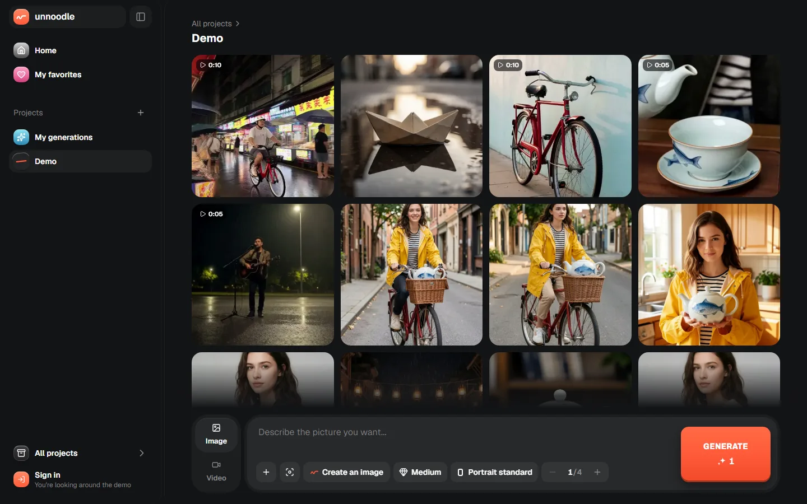
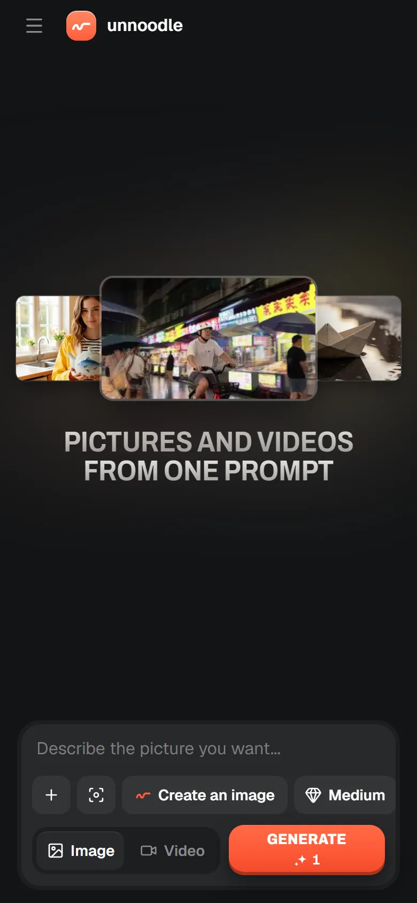
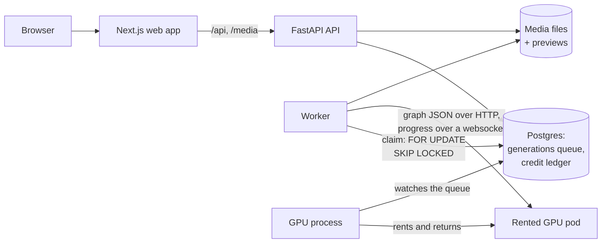

# unnoodle

Pictures and videos from one prompt. Describe what you want, attach a photo or a clip if you have one, and press
Generate. No nodes to wire and no settings to learn.

**Stack:** Next.js, TypeScript, Tailwind · FastAPI, SQLAlchemy, Postgres · Docker, GitHub Actions · GPUs rented on
demand


Open image and video models are good now, but running them usually means a canvas of nodes, model files and settings
with names like CFG and denoise. unnoodle does that part on the server: it picks the model from what you ask for and
what you attach, builds the steps for that one request, and runs them on a GPU that it rents only while there is work.

It runs at [unnoodle-xi.vercel.app](https://unnoodle-xi.vercel.app). New accounts start without credits (for now they
come with invite codes), and [`/demo`](https://unnoodle-xi.vercel.app/demo) shows the studio without an account.

<p>
  
  
</p>

## What it does

| Ask for                                                                                                        | In the app                   | Out of the app                                                                                                              |
| -------------------------------------------------------------------------------------------------------------- | ---------------------------- | --------------------------------------------------------------------------------------------------------------------------- |
| A picture: _a white ceramic teapot painted with a blue fish, product photo on a white table_                   | Image generation             |                                                                 |
| An edit of one photo: _@photo1 wears a black leather jacket instead of the raincoat, same pose and background_ | Image editing                |  →  |
| A mix of photos: _@photo1 holds the teapot from @photo2 in both hands, in a sunny kitchen_                     | Image editing, 1–3 photos    |                                                                |
| A video with sound, from text, photos or clips: _@photo1 pours tea from the teapot in @photo2 into a cup…_     | Video generation, with sound | the middle video above                                                                                                      |

- **Settings in words:** low, medium or high quality; a shape like portrait or wide, or "same as" an attachment; 5, 10
  or 15 seconds for a video.
- **@mentions:** each attachment gets a handle (`@photo1`, `@clip1`) so the prompt can say which is which.
- **Up to four at once:** one tap queues several takes of a prompt, each with the next seed.
- **Projects:** generations go in folders, and anything you made can go back in as an input.
- **Prices up front:** every generation costs a fixed number of credits, shown on Generate before you press it.
- **An admin page:** everyone's generations, people and their credits, invite codes, banned words, and the GPU's usage
  with a Stop button.

## How it works



- **One address for the browser.** The browser only talks to the Next.js app, which passes `/api/*` and `/media/*` to
  the API, so there's no cross-origin setup and the sign-in cookie stays first-party. While anything is queued or
  running, the app re-reads the generations every second; otherwise only when the tab regains focus.
- **The queue is a table.** `POST /generations` checks the request, charges for it and inserts rows; a Postgres
  `NOTIFY` wakes an idle worker. A worker claims the oldest queued row with `SELECT … FOR UPDATE SKIP LOCKED`, so
  several workers never take the same job, and then holds it as a lease: it refreshes a heartbeat while it runs, and a
  job whose heartbeat goes stale for 60 s is claimed again, up to 3 attempts. A run that takes more than 3× its
  estimate (never less than 2 minutes) is stopped on the renderer and failed with a plain message.
- **Pipelines are code.** Each model is a pipeline: what it accepts (photos and clips per role), what it offers
  (qualities, shapes, lengths), and a function that builds the node graph for one request, with one image chain per
  attached photo. Routing picks the pipeline from the mode and the attachments, and the worker sends the built graph to
  the renderer, a node-graph inference server. `app/pipelines.py` describes the contract; `app/catalogues/real.py` holds
  the three real pipelines and `app/catalogues/dev.py` stand-ins that need no GPU.
- **A GPU only while there is work.** A separate process (`python -m app.gpu`) watches the queue. When something waits
  and no GPU is up, it rents one on RunPod, sets up the renderer and downloads the models one pipeline at a time; the
  worker claims only jobs whose pipeline is ready, so a picture can run while the video model is still coming in. It
  reaches the pod's renderer through an SSH tunnel, with a key it makes for itself. Five things keep a forgotten GPU
  from running on:
  1. it hands the GPU back after 5 minutes without work;
  2. a daily limit on GPU time (2 hours), after which waiting work fails with its credits refunded;
  3. every few minutes it deletes any pod of this app that isn't the one it is using;
  4. the pod deletes itself if this process stops checking in for 10 minutes;
  5. a spend limit on the RunPod account, as the last line.

  Admins see the sessions, the time used today and a Stop button; queued tiles show whether the GPU is starting.

- **Everything is scoped to its owner.** Every query filters by the signed-in account; someone else's generation,
  upload or project answers 404, and `/media` files are served only to their owner (plus a shared Demo project that
  every account can read). Sessions are random tokens in an httpOnly cookie; the database keeps only their SHA-256, and
  passwords are hashed with Argon2.
- **Credits are a ledger.** Every grant, charge and refund is a row in an append-only `credit_entries` table, so a
  balance is a sum and every change can be traced. Queuing charges under a row lock on the account, so two requests
  can't spend the same credits, and a failed generation is refunded in the same transaction that marks it failed.
- **Media.** Uploaded clips are cut with ffmpeg to what the video model uses. Every video gets a poster frame and every
  picture a WebP preview of at most 960 px, so grids never load the full file. Private media skips Next's image
  optimizer, which fetches without the visitor's cookie and caches for everyone.

## Decisions, with the numbers behind them

The real pipelines were run end to end on a rented 32 GB GPU, driven through the API.

| Generation                              | Time on the GPU |
| --------------------------------------- | --------------- |
| Picture, low to high quality            | 3–11 s          |
| Photo edit, 1–3 photos                  | 7–27 s          |
| Video, low, 5 s, from 2 photos          | 86 s            |
| Video, medium, 10 s, text only          | 253 s           |
| Video, medium, 10 s, with 2 video clips | 851 s           |

- **Reference clips are cut to 0.4 megapixels.** The video model works through every frame of a reference clip as well
  as the frames it makes, so the clip's size sets the speed. With a low 5 s output, seconds per step were 4.1 with no
  clip, 8.9 with a 0.25 MP clip, 15.8 at 0.5 MP and 34.4 at 1 MP: a clip at full size made the video about eight times
  slower. At 0.4 MP it is about three times slower. Step time follows the total size (frames × pixels) of the output and
  the clips together, and grows faster than linearly.
- **A clip costs extra.** Because of that, each clip attached to a video costs more credits, on top of the price per 5
  seconds of video.
- **Smart Queue.** With one first-in, first-out queue, a low-quality picture queued behind two videos waited 15 minutes
  for a job that then took 15 seconds. Smart Queue (opt-in, for admins, since it reorders everyone's jobs) orders by
  when a job was queued plus its estimated run time, counting at most 10 minutes of it: quick jobs go first, and a long
  one waits at most about 10 minutes longer than it would have.
- **Models one pipeline at a time.** A cold GPU can run pictures about 2–3 minutes after it is rented and everything
  after 4–5 minutes, once the video model is in. Loading the models per pipeline rather than all at once lets a picture
  go ahead in that gap, and nothing is kept between sessions, so an idle GPU costs nothing.
- **Real-speed stand-ins.** The dev renderer's node takes as long as the real model did on the GPU (a set-up phase with
  no progress, then steps), so progress bars, queue waits and time limits are built against real timing without one.
- **Resubmitting is cheap.** When the connection to the pod dropped mid-video, the worker released the job without
  using an attempt and sent it again on reconnect; the renderer finished the original and answered the identical
  resubmit from its cache in 0.0 s, so no GPU time was lost.

Not tested yet: high-quality video, 15 second video, running out of GPU memory.

## Layout

- `apps/web`: Next.js (App Router), Tailwind and shadcn/ui. `/` is the landing page for people who are signed out
  (signed-in visitors go to `/generate`, the app). Its pictures and videos are copies of Demo outputs in
  `apps/web/public/showcase`. `/demo` is the studio on a read-only copy of the Demo project (`src/lib/demo-snapshot.json`
  and `public/demo`, made with `uv run python -m app.snapshot ../web` from `apps/api`), so it can be looked around
  without an account and works even while the API is down.
- `apps/api`: FastAPI, SQLAlchemy 2, Alembic and Postgres. `app/worker` runs generations, `app/gpu` rents the GPU.
- `deploy`: the hosted setup; see [`deploy/README.md`](deploy/README.md).

## Hosting

The web app runs on Vercel. The API, the worker, the GPU process and Postgres run in Docker on one machine
(`deploy/compose.yml`, from an image that CI builds from `main`), reached through Tailscale Funnel or, on a plain
server, Caddy. Vercel passes `/api` and `/media` through to it. `/` and `/demo` are static, so they stay up even when
that machine is off. [`deploy/README.md`](deploy/README.md) has the steps.

## Running it

You need Node 24 with pnpm, uv, and Docker, and for videos ffmpeg (with ffprobe) on the PATH: the API uses it to cut
uploaded clips to what the video model uses and to make a still of each video.

```sh
pnpm install
pnpm dev                                # web app on http://localhost:3000

docker compose up -d                    # Postgres on 127.0.0.1:5432
cd apps/api
uv sync
uv run alembic upgrade head
uv run uvicorn app.main:app --reload    # API on http://localhost:8000; try GET /health
uv run python -m app.worker             # runs queued generations on the renderer (below)
```

The API queues generations in Postgres and the worker, a separate process, runs them on the renderer one at a time.
Several workers can share the queue. The web app passes `/api/*` and `/media/*` through to the API (`API_URL`, by
default `http://127.0.0.1:8000`).

Every setting has a working default. To change one, copy `.env.example` to `.env`; compose and the API both read it.
Pictures stored before previews existed get theirs with `uv run python -m app.previews` (from `apps/api`; safe to run
again).

### Accounts and credits

People sign up on `/sign-up` with an email and a password. After 5 wrong passwords for one email in 15 minutes, signing
in to it is refused until the oldest ages out. Set `UNNOODLE_SECURE_COOKIES=true` wherever the app is served over
HTTPS.

There's no email, so the first admin and forgotten passwords go through the command line (run from `apps/api`; in the
hosted setup, `docker compose exec api python -m …`):

```sh
uv run python -m app.users create you@example.com --admin
uv run python -m app.users set-password you@example.com   # also signs the account out everywhere
uv run python -m app.credits invite WELCOME --credits 50 --uses 20 --days 14
uv run python -m app.credits grant someone@example.com 100
```

Admins can do the credits part from `/admin` too. A demo project is shown to every account, so a new one has something
to look at: `uv run python -m app.demo <pipeline ids…>` files every finished generation of those pipelines into one
called Demo.

### The renderer

The renderer is a node-graph inference server: it takes a graph as JSON over HTTP, reports progress over a websocket
and serves the files it writes (`app/worker/renderer.py` makes every call). The one used here is
[ComfyUI](https://github.com/comfyanonymous/ComfyUI), 0.39 or later. To develop without downloading any models, start
it from the repo root with `dev/renderer` as its base directory:

```sh
python <path-to-renderer>/main.py --base-directory dev/renderer --port 8189 --cpu --disable-auto-launch
```

It then loads only the development node in `dev/renderer/custom_nodes`, and keeps its inputs, outputs and settings in
`dev/renderer` (git-ignored), so an existing install is left as it was. The node stands in for a model: it takes as
long as the real model would (a set-up with no progress, then steps), tints each image by the seed and writes the
prompt on it. It fails like a GPU out of memory when the prompt contains `#oom`, and finishes in a few seconds when it
contains `#quick`.

`UNNOODLE_PIPELINES` picks the catalogue: `dev` (the default) or `real`. For the real models, either point
`UNNOODLE_RENDERER_URL` at a renderer on a GPU with 32 GB of VRAM that has the model files `app/catalogues/real.py`
loads, or let the app rent one: set `UNNOODLE_GPU=runpod` with `UNNOODLE_RUNPOD_API_KEY` and `UNNOODLE_HF_TOKEN`, and
run `uv run python -m app.gpu` next to the worker (`deploy/.env.example` lists the limits).

### All of it at once

```sh
pnpm serve                              # everything, with a production build on http://127.0.0.1:18300
```

`pnpm serve` starts Postgres with docker compose if nothing answers yet, applies the migrations, then runs the API, the
worker and a production build of the web app, each line of output prefixed with the process it came from. It uses a
renderer that already answers at `UNNOODLE_RENDERER_URL`; otherwise it starts the dev one when
`UNNOODLE_DEV_RENDERER_MAIN` (and, for a portable build, `UNNOODLE_DEV_RENDERER_PYTHON`) says where it is. If any of
them stops, it stops the rest, and Ctrl+C stops them all.

To open it from another device without opening a port: with both on the same
[Tailscale](https://tailscale.com) tailnet, `tailscale serve --bg 18300` forwards
`https://<machine>.<tailnet>.ts.net` to it, with a real certificate, and `pnpm serve` prints that address once it is
up.

`pnpm test:e2e` builds into the same `.next` directory, so restart `pnpm serve` after running it.

## Checks

```sh
pnpm lint && pnpm typecheck && pnpm test

pnpm --filter @unnoodle/web exec playwright install chromium   # once
pnpm test:e2e                           # against a production build

cd apps/api
uv run ruff check . && uv run ruff format --check . && uv run mypy . && uv run pytest
```

API tests that need Postgres are skipped unless `UNNOODLE_TEST_DATABASE_URL` is set, which a `.env` copied from
`.env.example` does. They use their own database, which they create and migrate. The few that talk to a real renderer
also need the dev renderer running and `UNNOODLE_TEST_RENDERER_URL` set. CI runs all of the above on every push and pull
request, apart from the renderer tests, and checks that the generated API types are current.

The e2e tests answer the browser's API calls from `apps/web/src/lib/fixtures.ts`, so they need no API.
