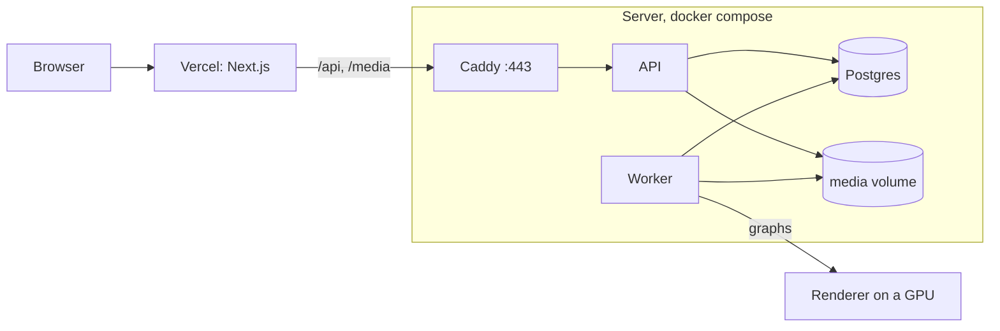

# Hosting

The web app runs on Vercel. Everything else runs in Docker on one small server: Postgres, the API, the worker and Caddy,
which gets an HTTPS certificate for the API by itself. Vercel passes `/api/*` and `/media/*` through to the API, so the
browser still talks to one address and the sign-in cookie stays first-party.



The API image is built from `main` by `.github/workflows/image.yml` and published as `ghcr.io/sm079/unnoodle-api`
(`latest` and `sha-<commit>`). The server only pulls it; nothing is built there.

## The server

A 1 GB DigitalOcean droplet (Ubuntu 24.04, Basic, Regular SSD, $6/month) is enough: nothing runs a model on it. Pick
the region closest to the people using it. Add your SSH key when creating it, then:

```sh
ssh root@<ip>

# 1 GB of swap, for headroom next to Postgres
fallocate -l 1G /swapfile && chmod 600 /swapfile && mkswap /swapfile && swapon /swapfile
echo '/swapfile none swap sw 0 0' >> /etc/fstab

curl -fsSL https://get.docker.com | sh
ufw allow OpenSSH && ufw allow 80 && ufw allow 443 && ufw --force enable

# The image is private while the repository is: a classic GitHub token with only read:packages
docker login ghcr.io -u <github user>

mkdir -p /opt/unnoodle && cd /opt/unnoodle
```

Copy `compose.yml`, `Caddyfile` and `.env.example` from this folder into `/opt/unnoodle`, then:

```sh
cp .env.example .env
nano .env                      # POSTGRES_PASSWORD, and API_HOST: api-<ip with dashes>.sslip.io
docker compose up -d           # migrations run before the API and the worker start
curl https://<API_HOST>/health # {"status":"ok","db":"ok"}
```

sslip.io answers any name that contains an IP address with that address, so there is a public name to get a certificate
for without buying a domain.

### Or: a machine on a tailnet, through Tailscale Funnel

Any machine with Docker and Tailscale can be the server instead, with Funnel in front in place of Caddy.
`compose.funnel.yml` publishes the API on that machine's loopback only (port 18400) and leaves Caddy out; Funnel then
gives it a public HTTPS name:

```sh
cd deploy
cp .env.example .env           # API_HOST is then only for reference
docker compose -f compose.yml -f compose.funnel.yml up -d
tailscale funnel --bg --https=8443 http://127.0.0.1:18400
curl https://<machine>.<tailnet>.ts.net:8443/health
```

The machine name is part of the public address, so name it in the Tailscale admin console first. Funnel opens only that
one port, Postgres isn't published, and the containers see only their named volumes, not the machine's files. The API
is up only while the machine is, which `/demo` covers: it needs neither.

## The web app

On Vercel, import the repository and set:

- **Root Directory:** `apps/web` (Vercel finds the pnpm workspace above it).
- **Environment variable:** `API_URL=https://<API_HOST>`. `next.config.ts` reads it at build time for the rewrites, so
  redeploy after changing it.

## Data

A new server starts empty. To carry over the accounts, the Demo project and their files from a machine that has them:

```sh
docker compose exec -T postgres pg_dump -U unnoodle -Fc unnoodle > unnoodle.dump   # on that machine
tar -C apps/api/media -czf media.tgz .
scp unnoodle.dump media.tgz root@<ip>:/opt/unnoodle/

# on the server
docker compose stop api worker
docker compose exec -T postgres pg_restore -U unnoodle -d unnoodle --clean --if-exists < unnoodle.dump
docker compose run --rm -T --entrypoint tar api -xzf - -C /data/media < media.tgz
docker compose up -d
docker compose exec api python -m app.previews     # previews for pictures stored before they existed
```

People and credits are managed with the same commands as locally, run inside the API container, for example
`docker compose exec api python -m app.users set-password <email>` or `… python -m app.credits grant <email> 100`.

## Updating

Merging to `main` publishes a new image. On the server:

```sh
docker compose pull && docker compose up -d
```

## Known limits

- **Vercel stops a proxied request after 30 seconds.** An upload has to reach the API within that time, so a large clip
  on a slow connection fails. Pictures and short clips are fine.
- The API sees Vercel's address, not the visitor's, so there is still no per-IP limit; the sign-in limit is per email.
- No automatic backups yet: a `pg_dump` and a copy of the media volume are the backup.
